We met at the airport at around 0145, placed our hiking bags and sticks into a bigger storage bag before checking it in. We each carried a small bag to store electronics such as powerbanks, batteries and the DJI camera I got for the trip.

We arrived in Hainan around 0830 and went to Haikou city to spend our 4-5 hours before our transit flight to Kunming.

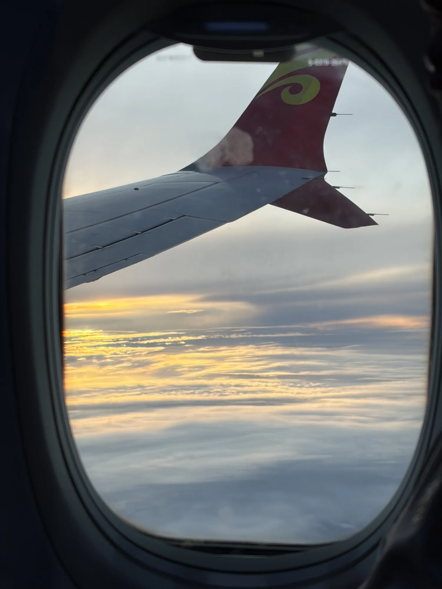
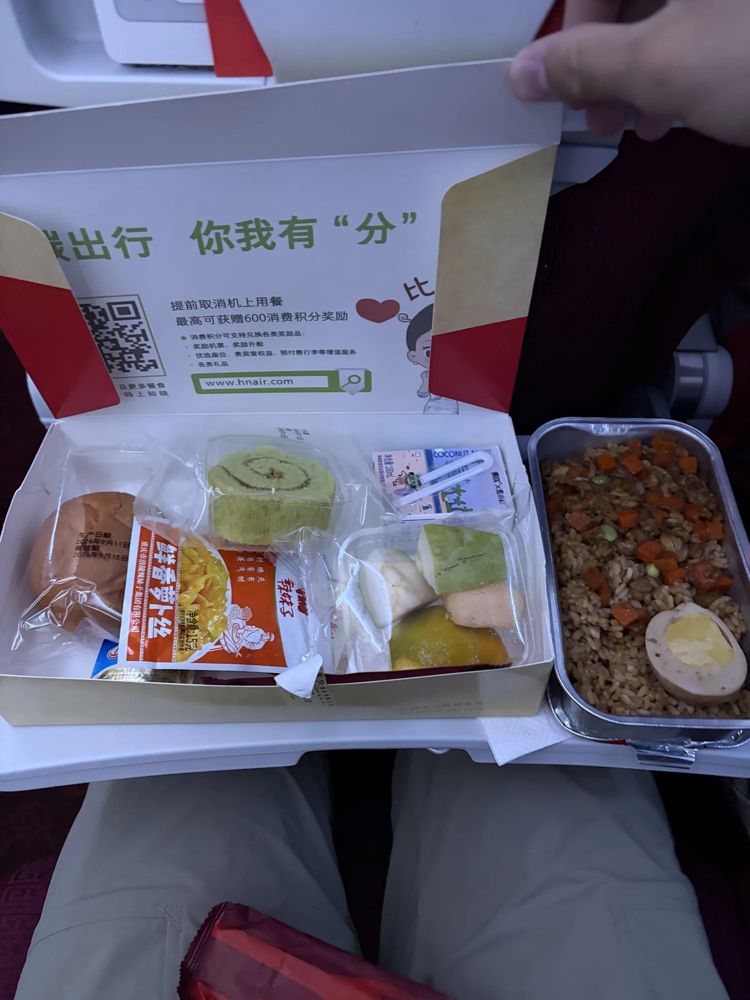

We did some quick research for tourist spots and took a Didi to Qilou Old Street (骑楼老街), which translates to arcaded shophouse. The building architecture is reminiscent of the shophouses in Chinatown, Singapore, as, apparently, its design was brought back from South East Asia by overseas Chinese merchants in the late 19th century.

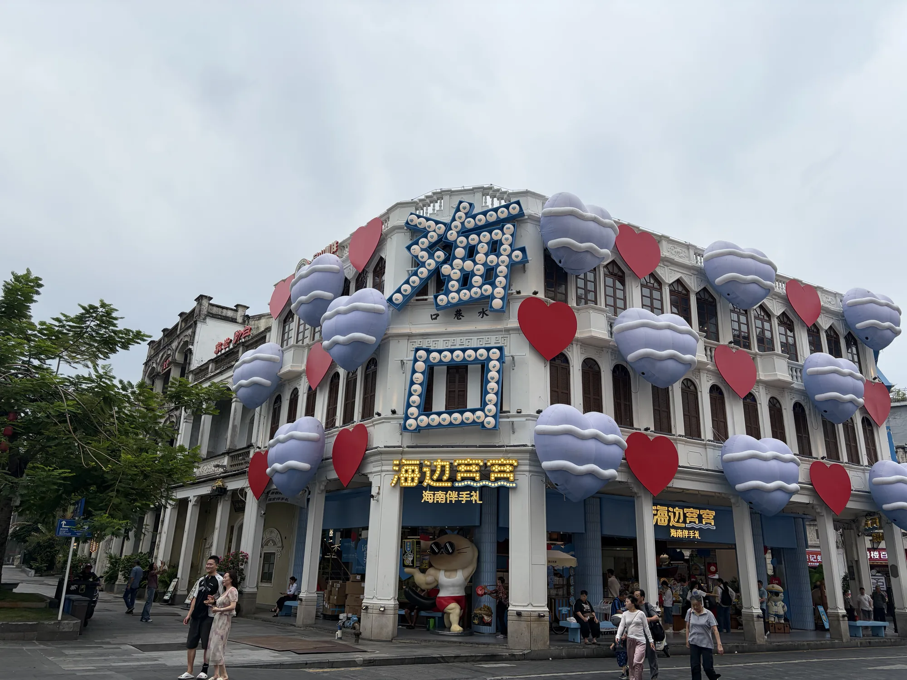
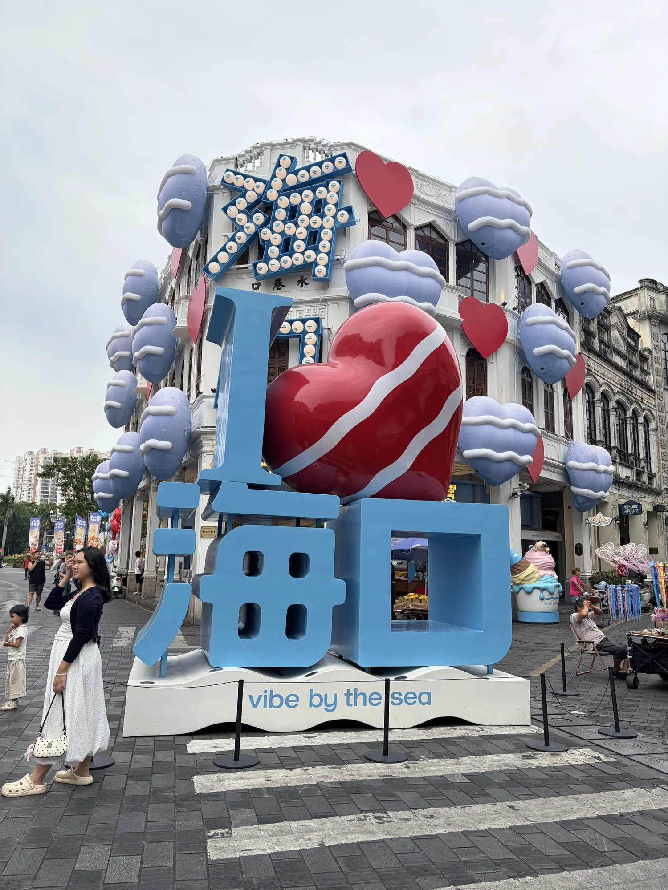
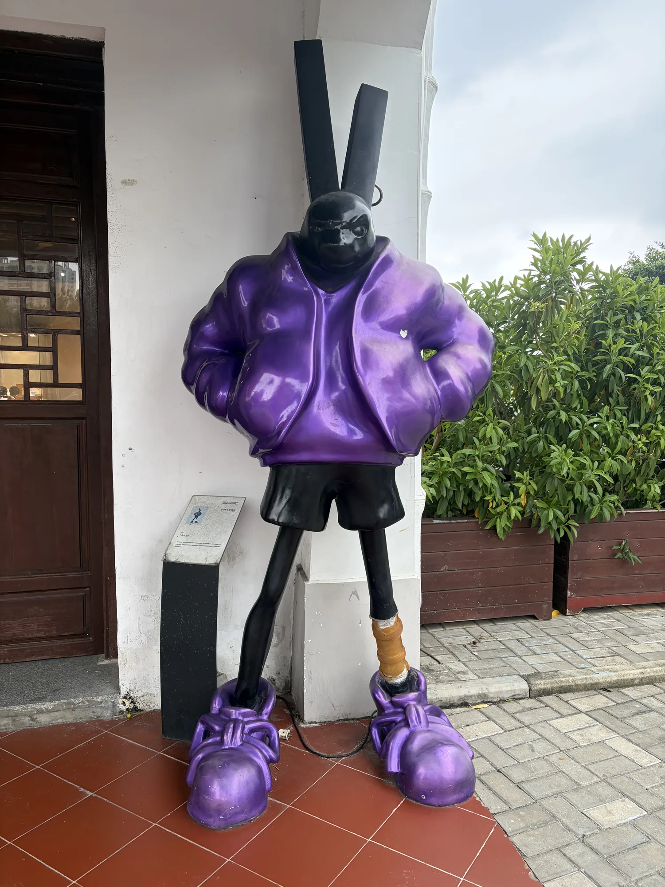

The street fortunately wasn’t bustling when we reached and we managed to walk almost the entirety of the main attraction area. We eventually ventured further in where it looked more like the regular local neighbourhood area.

[photo-only]
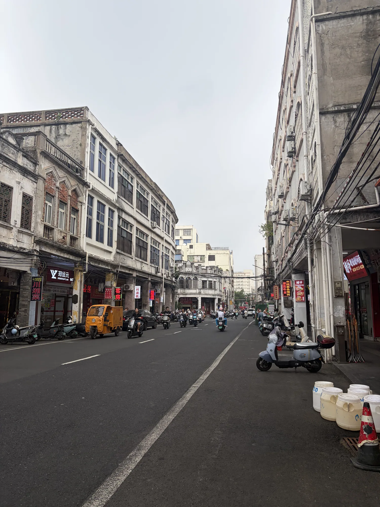
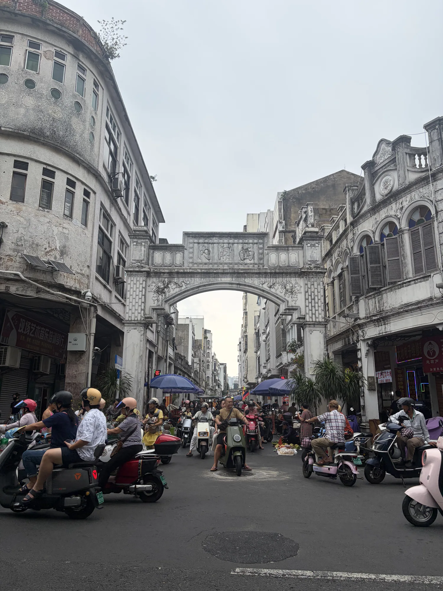

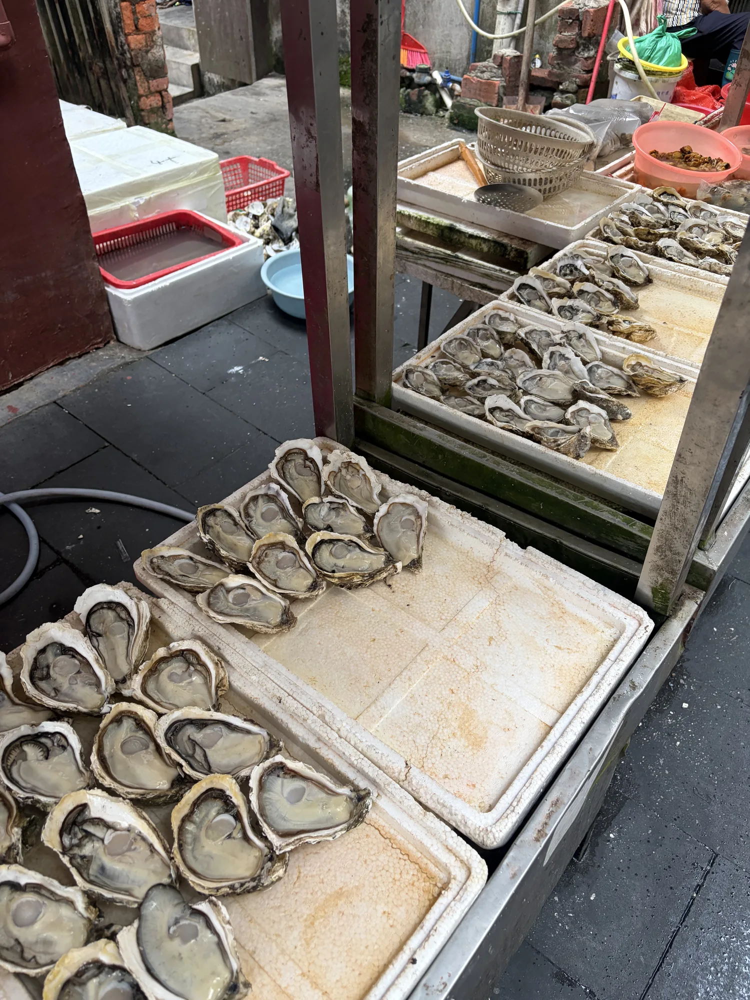
[/photo-only]

There was a food street market and we got some freshly squeezed sugar cane juice, rice cakes and passion fruit flavoured thousand layer cake. It felt pretty underwhelming since I could see the similarities to those in Singapore and slightly interesting due to the intersection of cultures.

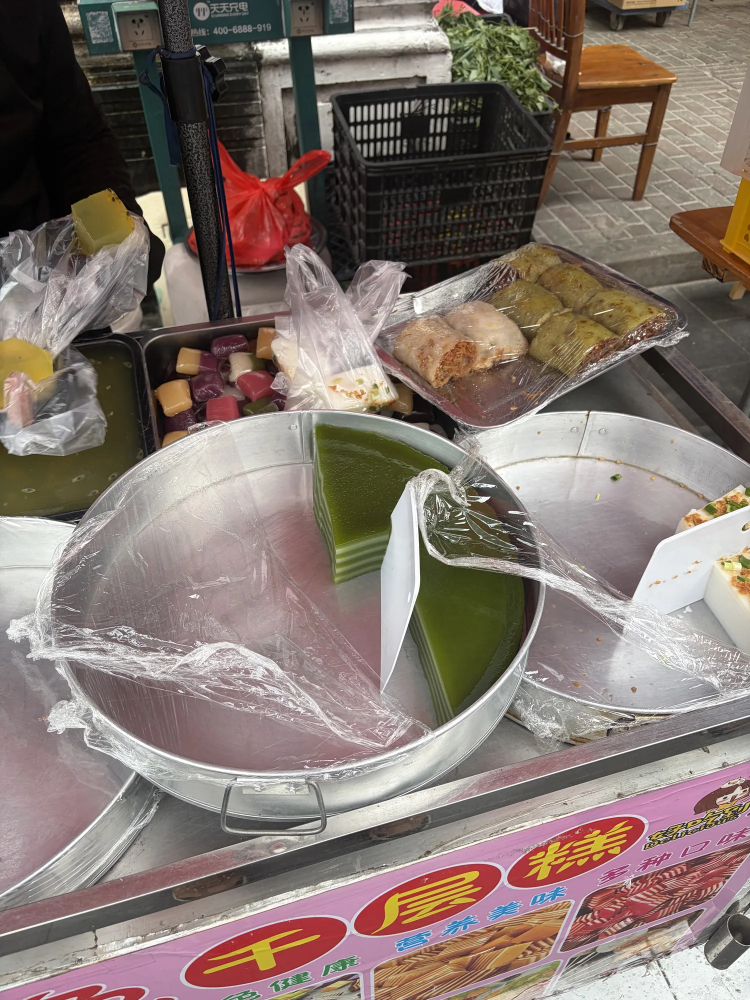
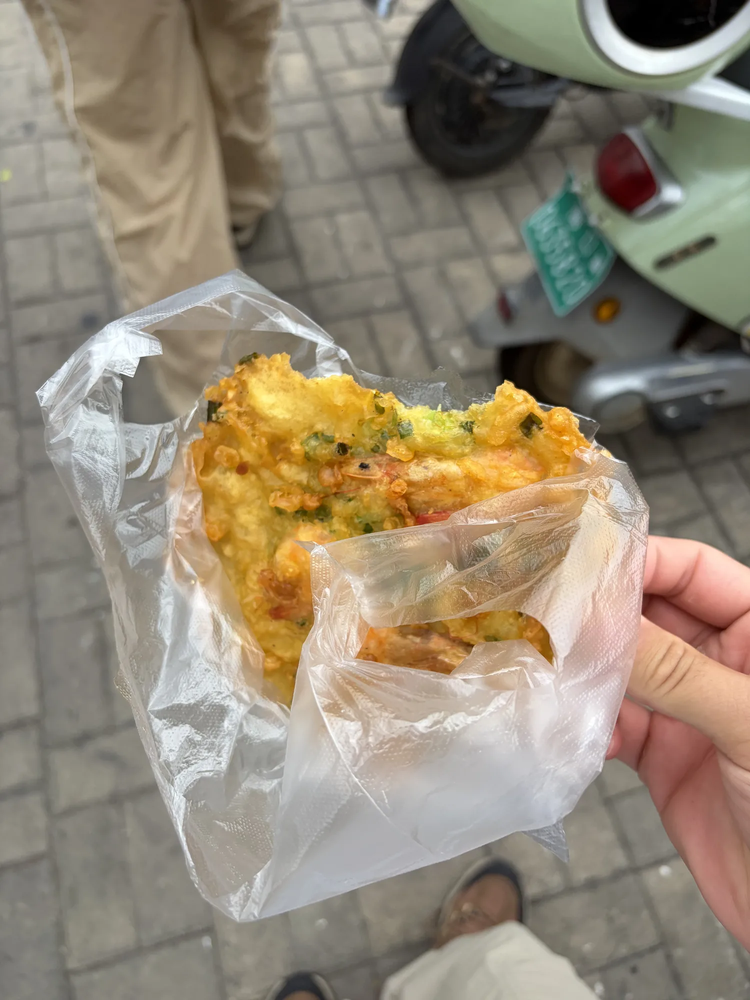
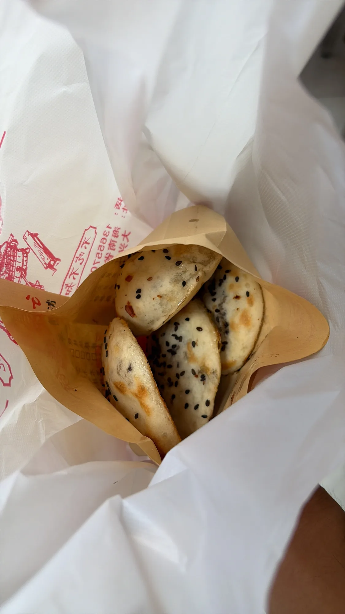

We headed back to the airport to catch our flight to Kunming, ate dinner at the station and subsequently took the high speed rail to Dali to check into the stay.

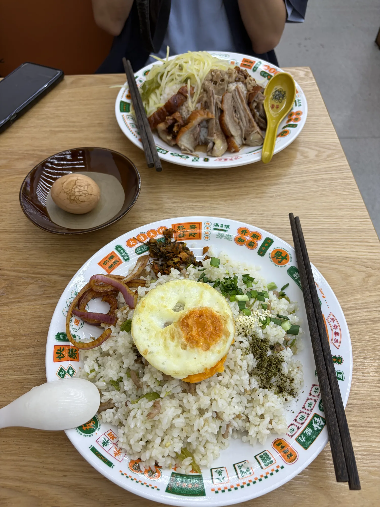