[full-width]
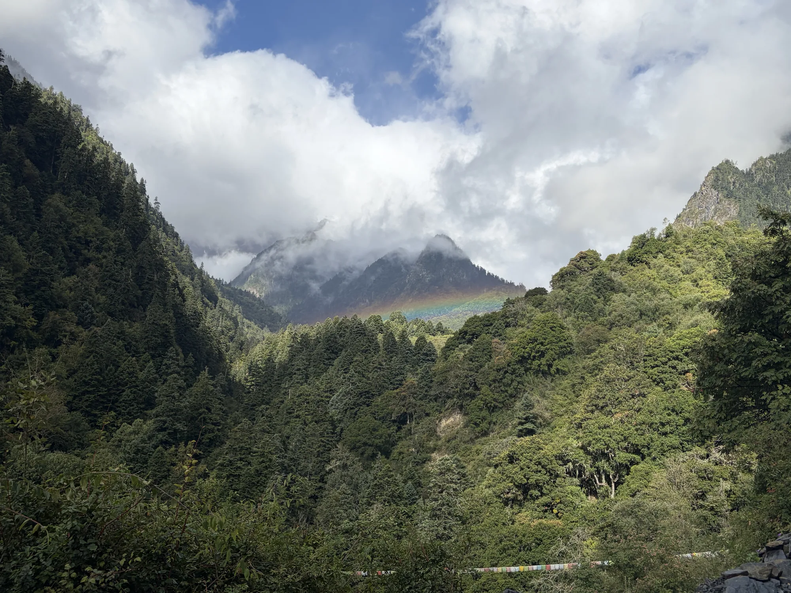
[/full-width]

Next day, we headed out of Yubeng early at nine. The hike down was significantly easier but extremely taxing on the knees. I had knee issues even weeks after the trip.

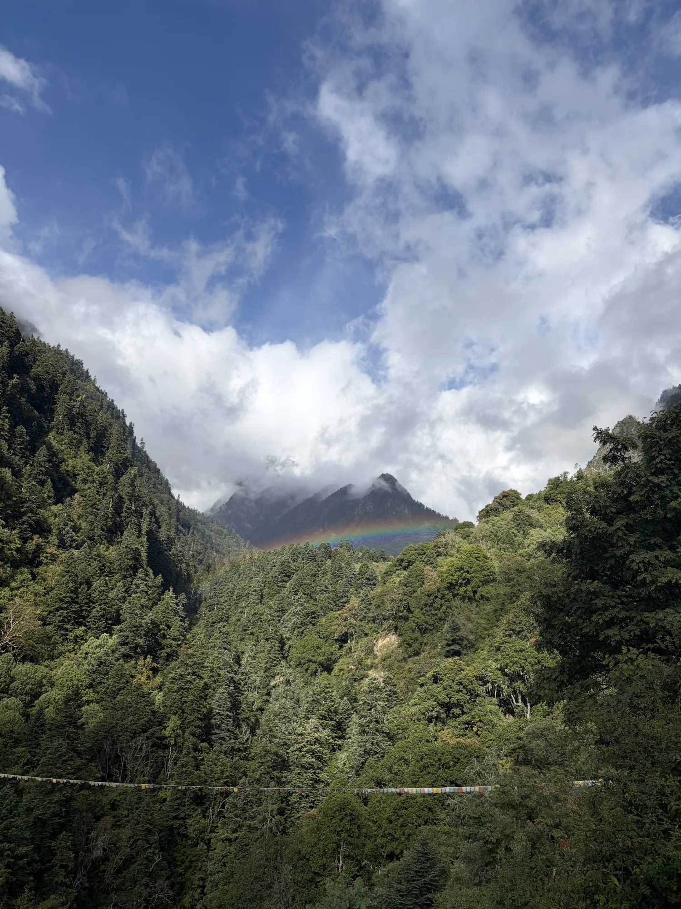
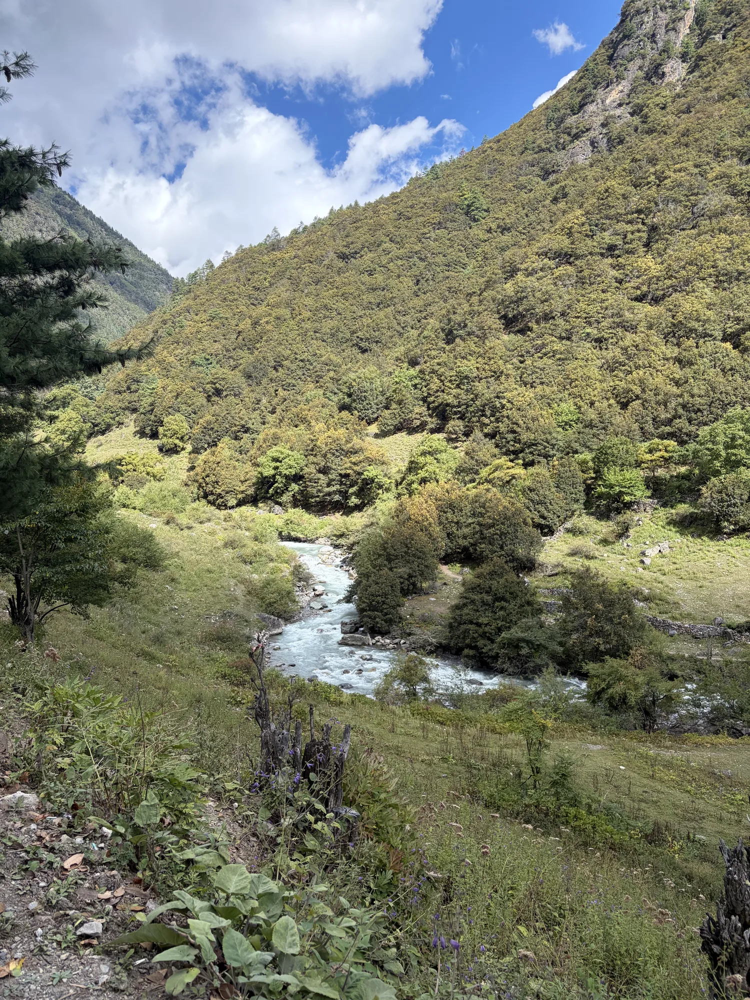
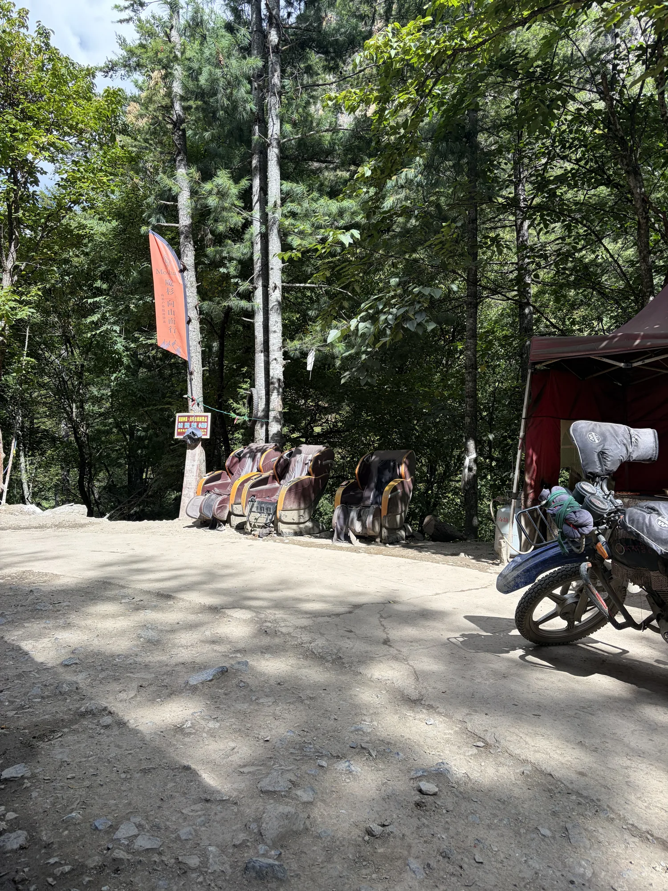
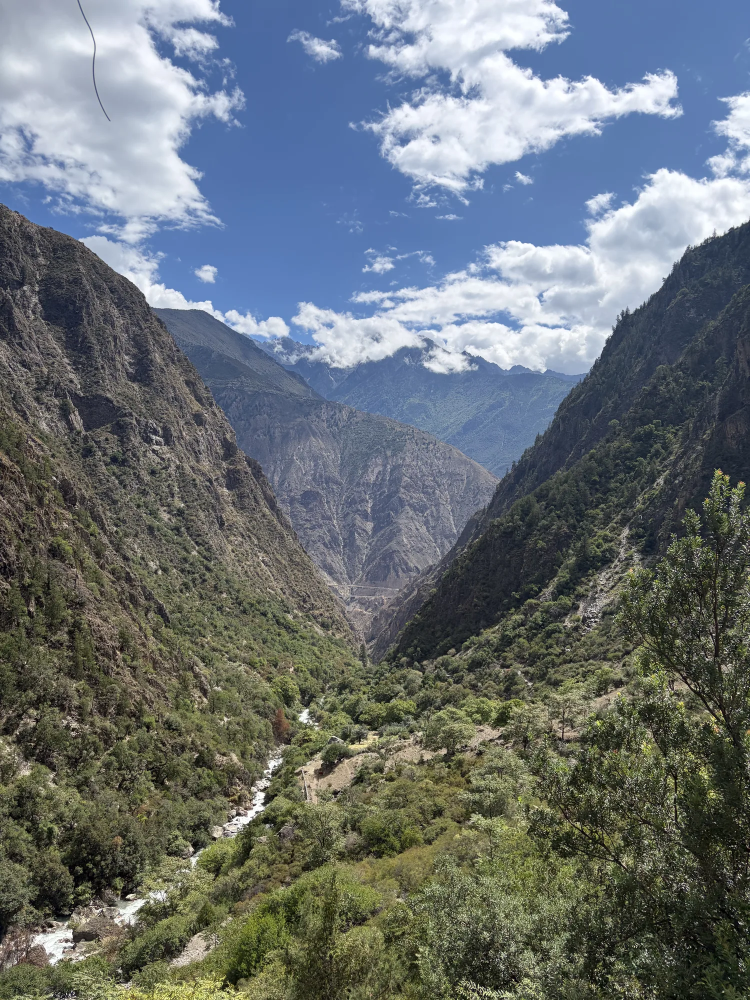
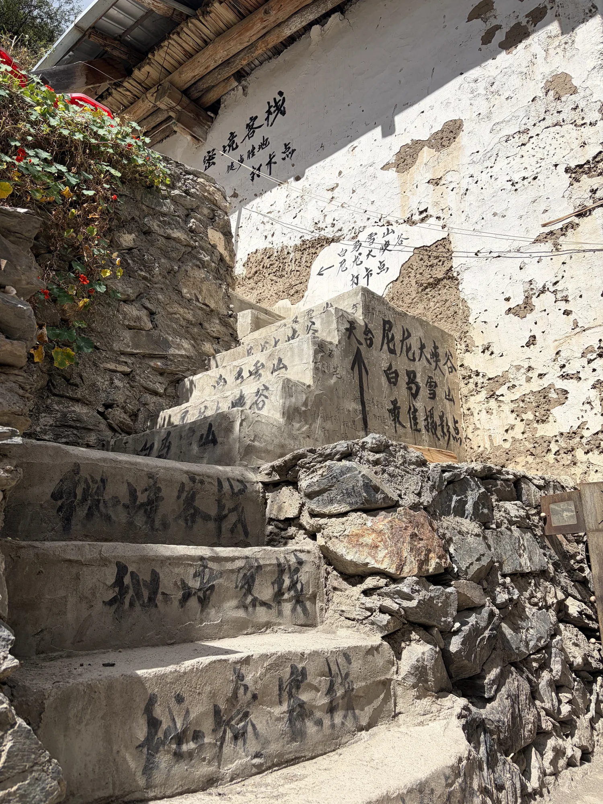
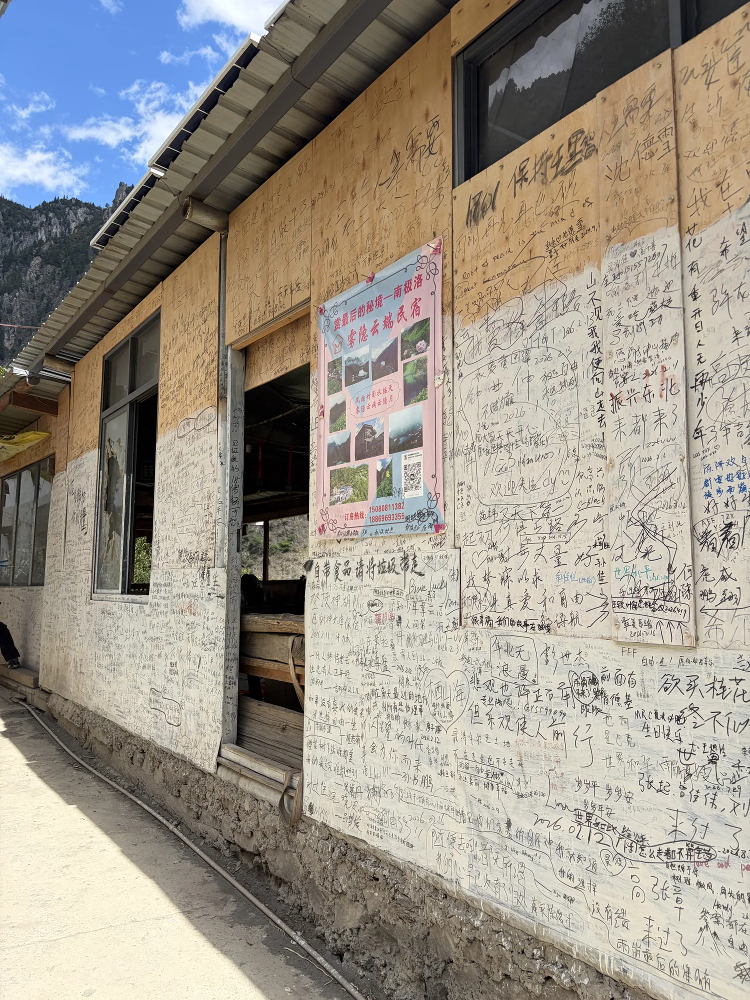

At the end of the descent, some random dude started waving to us, and promptly explained that he was here waiting for us (which technically wasn’t wrong), since he was waiting around for hikers to fetch back to Shangrila. This wasn't our plan but he offered less travelling time than the public bus (the transport we took to get here) and dropping us off near our destinations. We ended up agreeing. We had a quick meal at a shop right beside his van, while he continued finding a few more passengers.

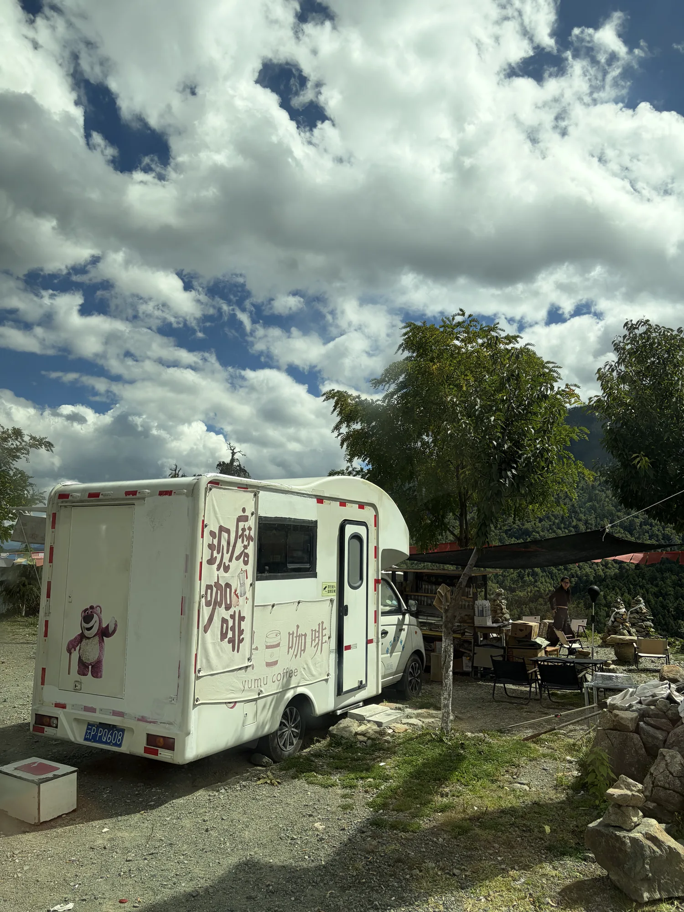
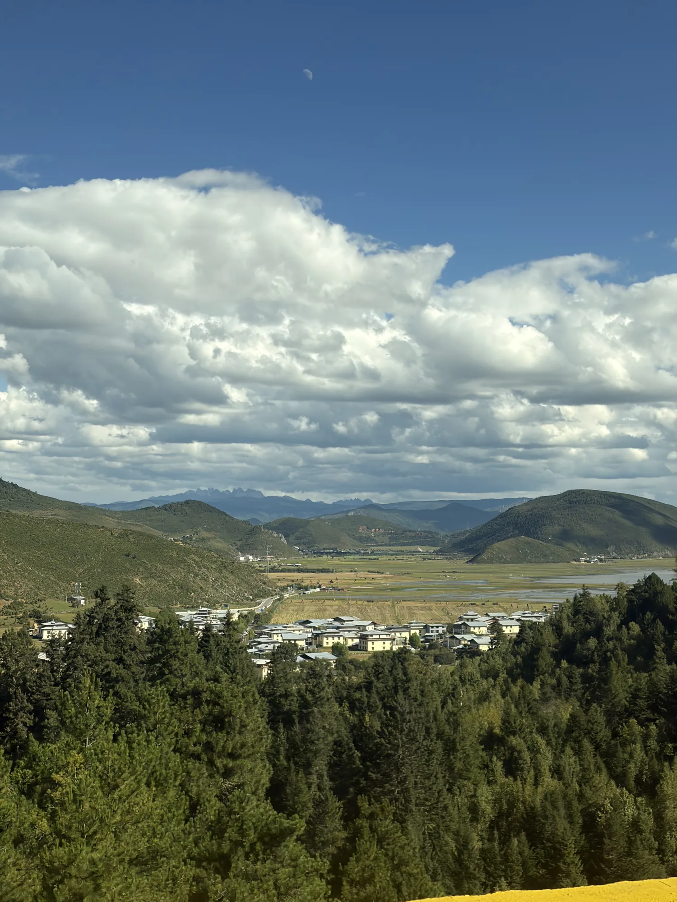

The ride proved to be quite engaging. We ended up talking to two other hikers, one was a male hiker from Zhejiang, who only had enough time to hike the most challenging Sacred Lake trail, another was a female English high school teacher in Shanghai. Both of them were pretty experienced hikers. The guy showed us some of his photos he took at the peak of the Sacred Lake hike, which he described as indescribable compared to the actual feeling of being at the top. There, he could see the 13 peaks of the Meili Snow Mountain Range. Both of them shared their past hiking experiences as well. Given their knowledge, I got them to recommend some places to me to visit in the future.

We alighted at Dukezhong Ancient Town, exchanged WeChat with the Zhejiang dude, returned to our previous lodging and collected the box of 鲜花饼 we left there, chatted with the host for a bit. They offered us some kind of fruit, probably called Yunnan olives.

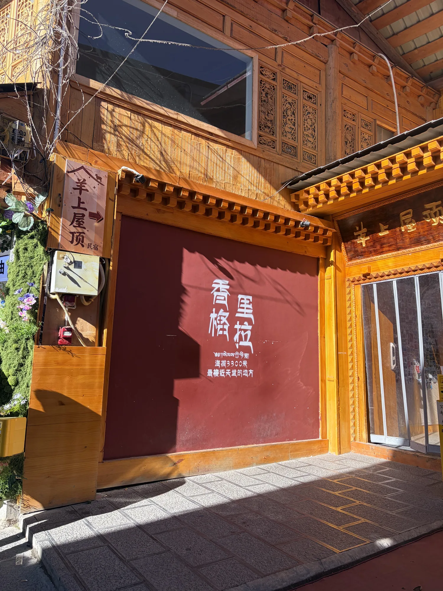
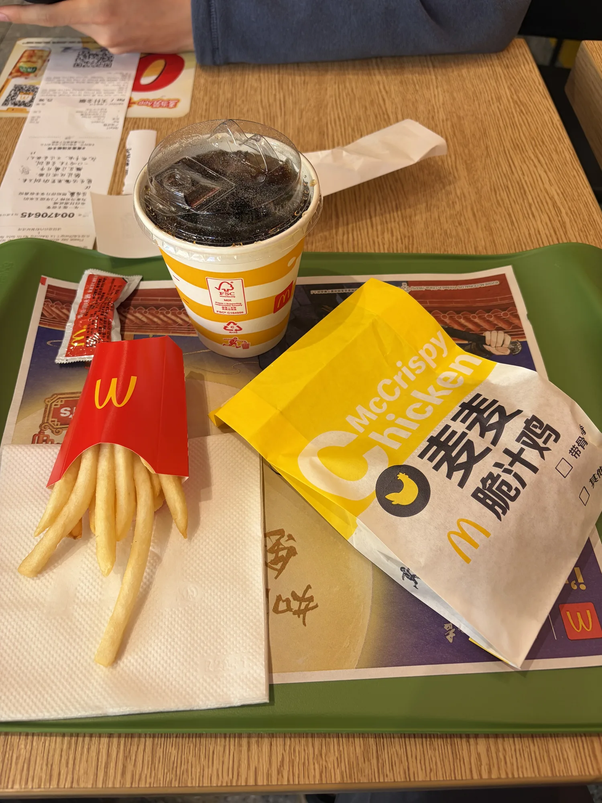

We headed off to catch our train back to Lijiang.

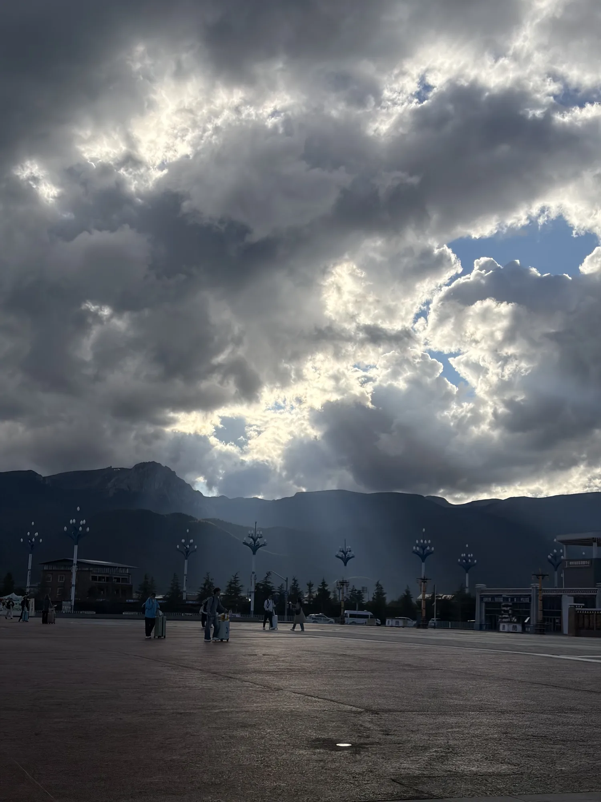
 
Coincidentally, we met the Zhejiang dude on the train. Once we arrived at Lijiang, I took the opportunity to ask the Zhejiang dude some things to do for a day in Lijiang. He recommended us 玉湖村 (Jade Lake Village), some ways north of Lijiang.

We headed to our hotel to rest for the day. The hotel was pretty amazing, given its cheap price and located within Lijiang Ancient Town.

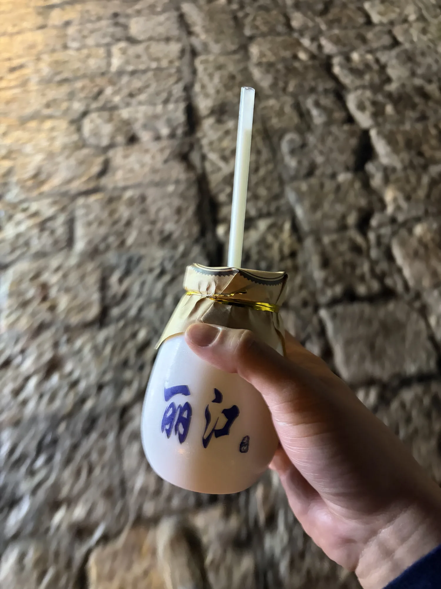
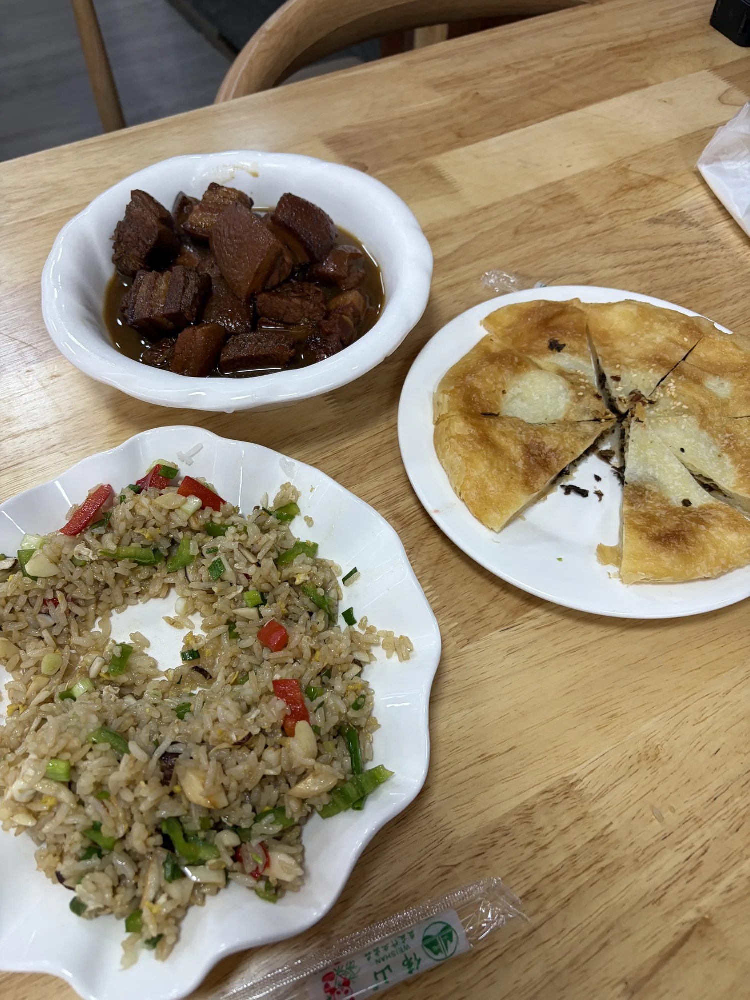