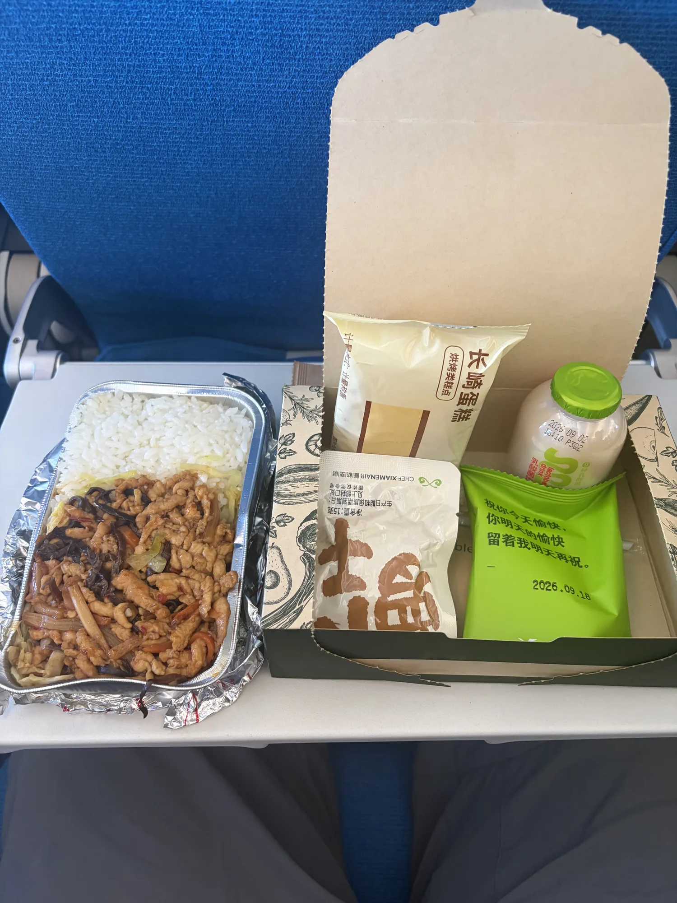
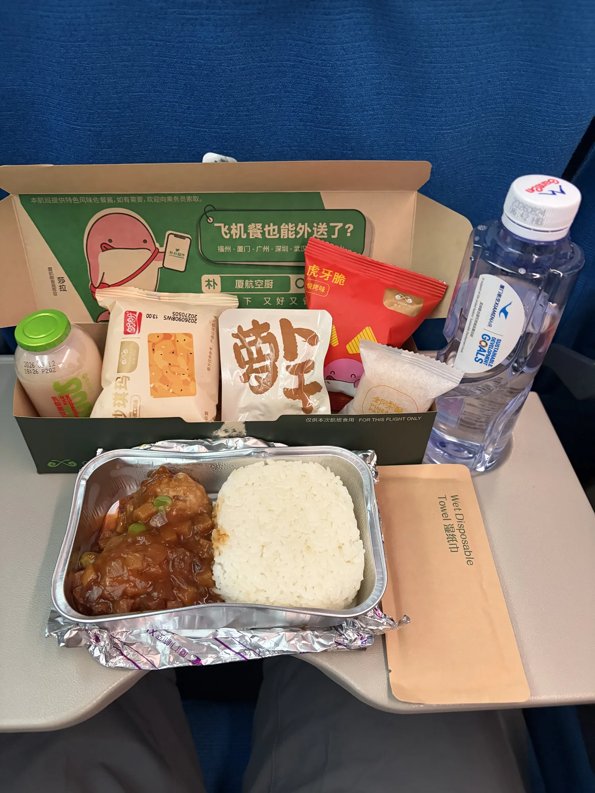
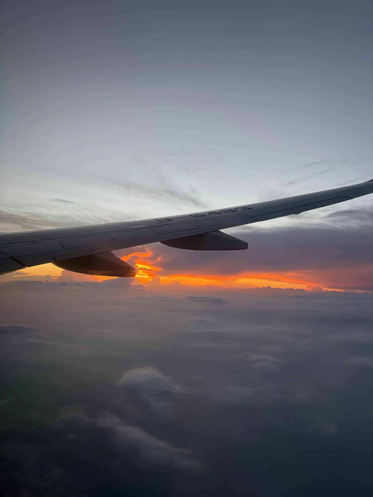

We arrived at Kunming Railway Station around five in the morning, and got breakfast nearby. There were many makeshift pushcarts around and quite a few restaurants open. I was craving for some youtiao but unfortunately none of the shops had it…

After eating, we decided to walk towards the second nearest metro to take to the airport as we decided to explore a bit. The city was quiet, some pedestrians walking about, some cleaners sweeping the street.

Most of the time on the last day was spent travelling. We took the plane to Xiamen, got our first Chagee of the trip at the airport, and headed off to the departure hall to wait for our flight back to Singapore.

